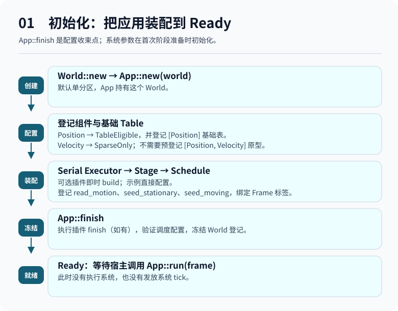
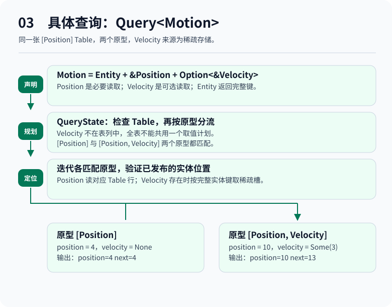

# pi_ecs

pi_ecs 是一个面向宿主显式驱动的 Rust ECS。当前可运行的是 `rc` 单线程模式：宿主组装 World 和 Schedule，再显式运行指定调度。它使用 **带拥有计数的实体生命周期、分区感知的存储和系统内即时结构写入**。如果你熟悉 Bevy ECS，可以沿用系统参数、Bundle 和查询的阅读习惯，但不要沿用它们的运行时假设。

## 与 Bevy ECS 有什么不同？

下表对照 Bevy ECS 0.17.2 的公开 API；这些是语义差异，不是性能比较。

| 主题 | pi_ecs（RC） | Bevy ECS 0.17.2 |
| --- | --- | --- |
| 实体生命周期 | 裸 `Entity` 只是 World 本地的代际键；`OwnedEntity` 表示一份 strong 责任，关系容器也可持有。strong 归零先登记，由维护收束销毁；归零到隐藏位置之前仍可能被查询。 | [`Entity`](https://docs.rs/bevy_ecs/0.17.2/bevy_ecs/entity/struct.Entity.html) 是标识；持有这个 ID 不保活实体。通常通过明确的 despawn 操作及其生命周期机制移除实体。 |
| 分区与存储 | 出生域编码在键中，当前位置另存当前分区。手工迁区不搬组件。同一张基础 Table 可承载多个原型；`TableEligible` 组件在所选表覆盖时走列，否则走稀疏。 | 组件声明自己的 [`StorageType`](https://docs.rs/bevy_ecs/0.17.2/bevy_ecs/component/enum.StorageType.html)：默认 `Table`，或选择 `SparseSet`；不会因每个实体所选的基础表不同而切换该类型的存储。 |
| 系统内结构修改 | `Spawn<B>` 和 `QueryAlter<Q, F, Add, Remove>` 直接写入并在调用返回前发布。阶段排序会考虑潜在原型；阶段内只刷新后续系统的匹配，不临时重排。 | 常见系统参数 [`Commands`](https://docs.rs/bevy_ecs/0.17.2/bevy_ecs/system/struct.Commands.html) 排队，在 `ApplyDeferred` 执行时应用；Bevy 也能通过独占 World 访问直接修改。 |
| 执行 | 宿主显式调用 `App::run(label)`。Schedule 依次运行 Stage；RC 只接受串行 Executor，并从访问声明推导阶段内顺序。 | Bevy ECS 的 Schedule 也可由宿主直接运行；[执行器](https://docs.rs/bevy_ecs/0.17.2/bevy_ecs/schedule/enum.ExecutorKind.html) 提供多线程选项，系统顺序可通过配置显式表达。 |
| 查询结果与变化 | `Query` 用于只读，`QueryMut` 用于可写；组件策略可给出关系容器专用访问对象。除了活值 tick 过滤，还可通过独立订阅读取 `Removed` 的旧组件值。 | 同一个 [`Query`](https://docs.rs/bevy_ecs/0.17.2/bevy_ecs/system/struct.Query.html) 可描述共享或可变访问；[`RemovedComponents<T>`](https://docs.rs/bevy_ecs/0.17.2/bevy_ecs/lifecycle/struct.RemovedComponents.html) 提供移除事件中的实体 ID，不提供旧组件值。 |

pi_ecs 的类型化命令队列另有模拟时间、定时和取消功能；它不是上述结构参数的延迟提交缓冲。

## 运行示例

从仓库根目录运行。构建依赖 [Cargo.toml](Cargo.toml) 中的相邻本地仓库，请按其中的相对路径布置依赖。

```sh
cargo run --locked --features rc --example motion
```

[完整示例](examples/motion.rs) 在同一 Stage 登记两个 Spawn 系统和一个查询系统。它先登记读者；阶段排序让两个写者先执行，所以读者能在这一轮看到两种实体：

```text
position=4 next=4
position=10 next=13
```

## 1. 初始化

创建 World 和 App，登记组件与基础 Table，组装 `Executor → Stage → Schedule`。`App::finish()` 验证配置并冻结登记；**它不会运行系统**。



## 2. 执行一轮

宿主调用 `App::run(frame)`。Stage 初始化系统参数、应用变化追踪需求并准备阶段计划；串行执行器在每个系统启动前刷新匹配，并为这次运行提供 `this_run`。成功的 Stage 在退出前回收通知并收束归零实体；最后由宿主调用 `App::close()` 有序关闭。


## 3. 一个具体查询：Motion

示例用具名 `QueryData` 返回实体键、必需的 `Position` 和可选的 `Velocity`：

```rust
#[derive(QueryData)]
struct Motion {
    entity: Entity,
    position: &'static Position,
    velocity: Option<&'static Velocity>,
}
```

两个原型共享一张 `[Position]` 基础表。因为表列不能证明每个变体都具有相同的 `Velocity` 来源，查询准备按原型分流：两种实体都从 Table 取位置；有速度的实体才按完整实体键读稀疏槽。`Query<'_, Motion>` 每次迭代给出一个具名 `MotionItem`。



## 当前范围与文档

RC 支持串行调度、宿主显式迁区、类型化结构参数、查询、资源、可靠通知和定时命令。非 RC 运行、并行执行、快照恢复、自动判区和外层执行图不属于当前支持范围。

- [概念与术语](design/unified-partitioned-ecs/concepts.md)
- [实现设计与源码索引](design/unified-partitioned-ecs/design.md)
