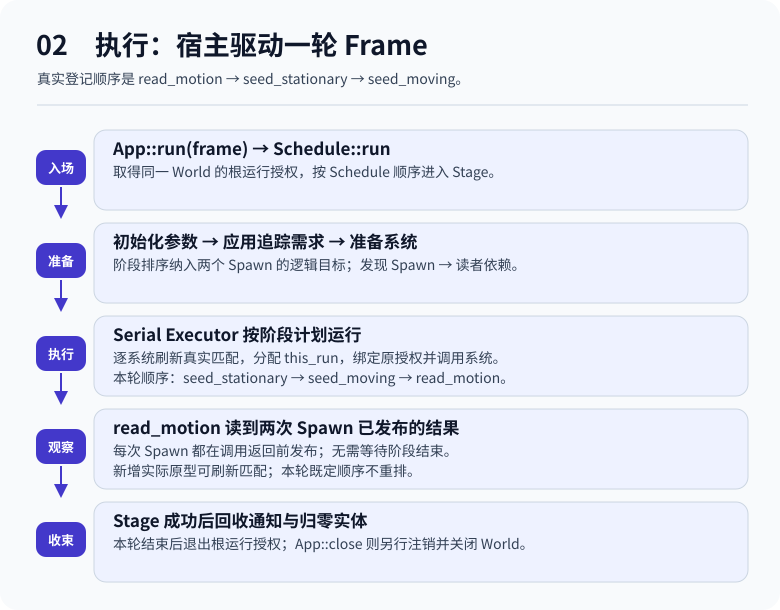
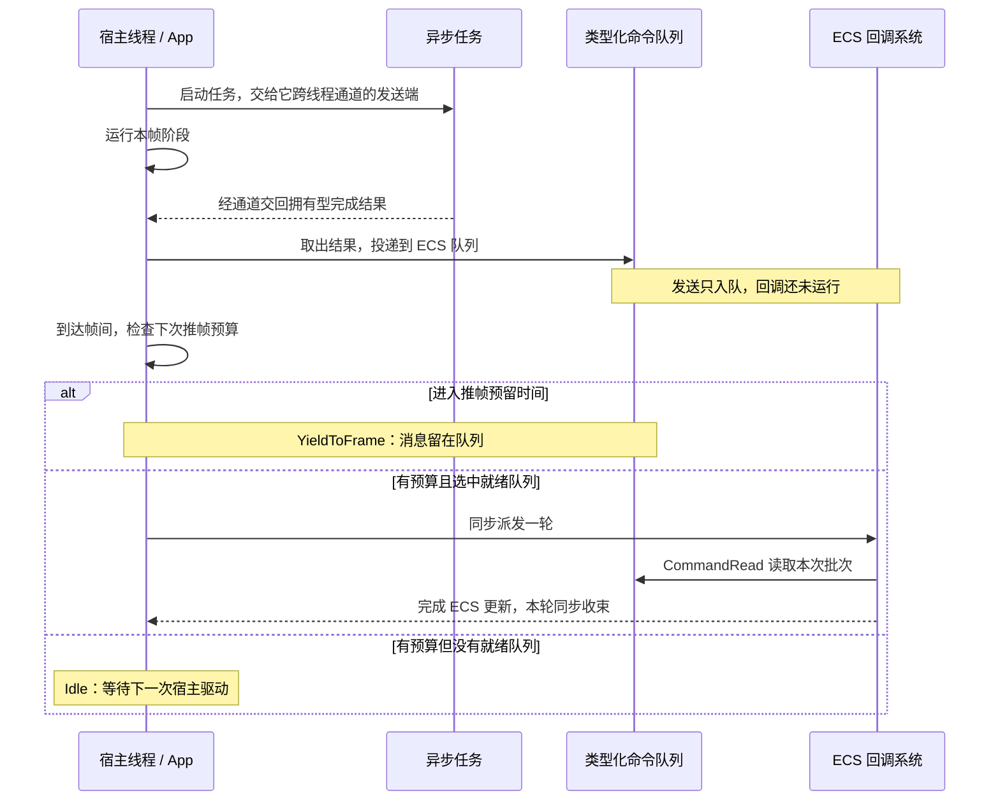

# pi_ecs

pi_ecs 是一个由宿主显式驱动的 Rust ECS，当前支持 `rc` 单线程模式。

- **带拥有计数的实体生命周期**：强引用和强关系容器可以保活实体。
- **分区感知的存储与即时结构写**：系统可在同一阶段看到先前系统发布的结构变化。
- **[系统输入与输出](#系统输入输出与阶段入口)**：按类型连接同一图里的系统，支持借用、移交所有权和整批回调。
- **[帧间调度与异步回调](#帧间调度与异步回调)**：宿主在推帧之间同步派发数据，或按优先级和帧预算消费异步完成消息。

## 与 Bevy ECS 的区别

以下对照 Bevy ECS 0.17.2 的公开 API，比较的是语义，不是性能。

| 主题 | pi_ecs（RC） | Bevy ECS 0.17.2 |
| --- | --- | --- |
| 实体生命周期 | 裸 `Entity` 只是 World 内的代际键；`OwnedEntity` 和强关系容器可以保活实体。最后一份 strong 释放后先登记，在维护阶段销毁。 | [`Entity`](https://docs.rs/bevy_ecs/0.17.2/bevy_ecs/entity/struct.Entity.html) 是标识，持有 ID 不会保活实体。 |
| 分区与存储 | 键记录出生域，位置另存当前分区；迁区不搬组件。同一个 `TableEligible` 组件在基础表覆盖它时走列，否则走稀疏存储。 | 组件选择 [`StorageType`](https://docs.rs/bevy_ecs/0.17.2/bevy_ecs/component/enum.StorageType.html)，默认 `Table`，也可选 `SparseSet`。 |
| 系统内结构写 | `Spawn<B>` 和 `QueryAlter<Q, F, Add, Remove>` 在调用返回前发布。后启动的系统可以在同一 Stage 看到新原型。 | [`Commands`](https://docs.rs/bevy_ecs/0.17.2/bevy_ecs/system/struct.Commands.html) 的队列在 `ApplyDeferred` 时应用；使用独占 World 也可以直接修改。 |
| 调度 | 宿主显式运行命名 Schedule，Stage 顺序执行。RC 仅支持串行执行器；阶段内根据访问声明推导顺序。 | Schedule 同样可以显式运行；[执行器](https://docs.rs/bevy_ecs/0.17.2/bevy_ecs/schedule/enum.ExecutorKind.html) 还支持多线程，系统顺序也可显式配置。 |
| 查询与移除通知 | 用 `Query` 读、用 `QueryMut` 写；关系组件返回专用访问对象。`RemovedReader<T>` 还能短借移出的旧组件值。 | [`Query`](https://docs.rs/bevy_ecs/0.17.2/bevy_ecs/system/struct.Query.html) 同时支持共享和可变查询；[`RemovedComponents<T>`](https://docs.rs/bevy_ecs/0.17.2/bevy_ecs/lifecycle/struct.RemovedComponents.html) 提供被移除组件的实体 ID，不提供旧值。 |

pi_ecs 的类型化命令队列有独立的模拟时钟、定时和取消能力，与 `Spawn` / `QueryAlter` 的即时发布是两套机制。

## 快速运行

外部依赖从 crates.io 获取，不要求克隆相邻仓库。从仓库根目录运行 [Motion 示例](examples/motion.rs)：

```sh
cargo run --features rc --example motion
```

```text
position=4 next=4
position=10 next=13
```

### 1. 初始化

宿主创建 World 和 App，登记组件及基础 Table，组装串行 Executor、Stage 和 Schedule。`App::finish()` 验证配置并冻结登记；此时还未执行系统，参数在阶段准备时初始化。


### 2. 执行一轮

宿主调用 `App::run(frame)`。Stage 初始化参数、应用跟踪需求并准备排序；Executor 在每个系统开始前刷新真实匹配并提供本次 `this_run`。示例先登记读者，但两个 Spawn 会按推导出的依赖先执行。Stage 成功后回收通知并收束归零实体；最后由宿主显式关闭 App。



### 3. 一个具体查询：Motion

`Query<'_, Motion>` 返回 `MotionItem`，字段是完整实体键、必需的 `Position` 和可选的 `Velocity`。两个原型共享一张 `[Position]` 基础表，但查询按原型分流：位置读表列；有速度时才按完整实体键读取稀疏槽，否则返回 `None`。


## 常见系统用法

下面是一份完整的一轮模拟，可作为使用本仓库的应用入口。它先创建实体，再用 `Res<Step>` 读取配置、用 `QueryMut` 更新位置，最后用过滤查询读回结果。最后一个系统用 `Local<u32>` 保存自己的调用次数，并把实体数量写入 `ResMut<Stats>`。注意：这里用不同 Stage 明确表达“创建 → 更新 → 统计”的业务顺序。

```rust
use pi_ecs::{
    core::query_filter::With,
    prelude::*,
    schedule::{
        executor::{ExecutionMode, Executor},
        local::{Local, LocalConfig},
        resource_param::{Res, ResMut},
        stage::{Stage, StageId},
        system::SystemId,
        system_builder::SystemBuilder,
    },
};

struct Position(i32);
impl Component for Position {
    type Access = PlainAccess;
}
struct Velocity(i32);
impl Component for Velocity {
    type Access = PlainAccess;
}

struct Step(i32);
struct Stats(usize);
struct Frame;

fn seed(mut spawn: Spawn<'_, (ComponentValue<Position>, ComponentValue<Velocity>)>) {
    let entity = spawn
        .spawn((ComponentValue(Position(10)), ComponentValue(Velocity(3))))
        .unwrap();
    // 这个一次性示例把初始 strong 的清偿留给 World 整体关闭。
    entity.forget();
}

fn advance(mut query: QueryMut<'_, (&'static mut Position, &'static Velocity)>, step: Res<'_, Step>) {
    for (mut position, velocity) in query.iter_mut().unwrap() {
        position.0 += velocity.0 * step.0;
    }
}

fn report(
    query: Query<'_, &'static Position, With<Velocity>>,
    mut stats: ResMut<'_, Stats>,
    mut calls: Local<'_, u32>,
) {
    *calls += 1;
    stats.0 = 0;
    for position in query.iter().unwrap() {
        stats.0 += 1;
        println!("位置：{}", position.0);
    }
    println!("第 {} 次统计，共 {} 个实体", *calls, stats.0);
}

fn main() -> Result<(), EcsError> {
    let mut app = App::new(World::new()?).map_err(|rejected| rejected.error)?;
    let mut world = app.world_mut()?;
    let position = world.register_component::<Position>(StoragePolicy::TableEligible)?;
    world.register_component::<Velocity>(StoragePolicy::SparseOnly)?;
    world.register_table(&[position])?;
    world.register_resource::<Step>()?;
    world.register_resource::<Stats>()?;

    let mut schedule = Schedule::new();
    let executor = schedule.add_executor(Executor::new(ExecutionMode::Serial)?)?;
    let mut create = Stage::new(StageId(0), executor);
    create.add_system(SystemBuilder::new(seed).build(SystemId(0))?).map_err(|rejected| rejected.error)?;
    let mut update = Stage::new(StageId(1), executor);
    update.add_system(SystemBuilder::new(advance).build(SystemId(1))?).map_err(|rejected| rejected.error)?;
    let mut inspect = Stage::new(StageId(2), executor);
    inspect.add_system(
        SystemBuilder::with_config(report, ((), (), LocalConfig::new(0)))
            .build(SystemId(2))?,
    ).map_err(|rejected| rejected.error)?;
    schedule.add_stage(create).map_err(|rejected| rejected.error)?;
    schedule.add_stage(update).map_err(|rejected| rejected.error)?;
    schedule.add_stage(inspect).map_err(|rejected| rejected.error)?;

    let frame = ScheduleLabel::of::<Frame>();
    app.add_schedule(frame, schedule).map_err(|rejected| rejected.error)?;
    app.finish()?;
    app.insert_resource(Step(2))?;
    app.insert_resource(Stats(0))?;
    app.run(frame)?;
    app.close()
}
```

预期输出为 `位置：16` 和 `第 1 次统计，共 1 个实体`。`LocalConfig` 按参数位置传入，前两个 `()` 分别是查询和资源的默认配置。必需资源要先登记类型，并在运行前插入值。

更多可直接参考的系统范例：

| 想做什么 | 参数与用法 | 仓库范例 |
| --- | --- | --- |
| 读取或修改实体 | `Query::iter()` / `QueryMut::iter_mut()`；`With<T>` 筛选有组件的实体，`Option<&T>` 在缺失时返回 `None` | [Motion](examples/motion.rs)、[系统参数](crates/pi_ecs_schedule/tests/system_params.rs) |
| 读写资源、保留系统私有状态 | `Res<T>`、`ResMut<T>`、`Option<ResMut<T>>` 和 `Local<T>` | [资源和 Local 用例](crates/pi_ecs_schedule/tests/system_params.rs) |
| 分时使用互斥参数 | `ParamSet` 用 `p0()`、`p1()` 依次短借；先结束上一个借用 | [同一资源分时写入](crates/pi_ecs_schedule/tests/system_params.rs) |
| 创建实体或为已有实体增删组件 | `Spawn<B>` 返回初始 strong；`QueryAlter<Q, F, Add, Remove>` 只接受匹配的实体和严格增删 | [Spawn](crates/pi_ecs_schedule/tests/spawn.rs)、[QueryAlter](crates/pi_ecs_schedule/tests/query_alter.rs) |
| 消费新增、变化或移除通知 | `AddedReader<T>` / `ChangedReader<T>` 读取通知头；`RemovedReader<T>` 还能读取旧值。每个读者持独立游标 | [通知与系统参数用例](crates/pi_ecs_schedule/tests/system_params.rs) |

## 系统输入输出与阶段入口

普通系统仍用 `SystemBuilder::new` 注册，默认是单位输入、无输出。需要传值时，用 `PortFunction` 声明输入端口和输出类型；系统参数（如 `ResMut`、`Query`）照常由 World 提供。运行时，`Some(value)` 交付一次，`None` 不触发下游。

### 例 1：到期任务整批交给阶段入口

同一个 `SystemFlow` 内，输出和输入按负载类型自动连线。一个生产者可以把值交给一个 `OwnedInput<T>`，或让多个 `SharedInput<T>` 消费者各短借一次。用 `DueBatch` 这样的业务类型区分不同数据流。以下片段假设 `stage` 是已创建的阶段、`DueTasks` 和 `ReadyTasks` 是已登记并插入的资源：

```rust
use pi_ecs::schedule::{
    inter_frame::SystemFlow,
    resource_param::ResMut,
    stage::Stage,
    system::{PortFunction, PortSignature, SharedInput, UnitInput},
    system_builder::SystemBuilder,
};

#[derive(Default)]
struct DueTasks(Vec<u32>); // 由应用的定时器填充
#[derive(Default)]
struct ReadyTasks(Vec<u32>);
struct DueBatch(Vec<u32>);

fn install_entry(stage: &mut Stage) {
    let mut entry = SystemFlow::new();
    entry.register::<(), _, _>(
        SystemBuilder::<_, PortSignature<ResMut<'static, DueTasks>>>::new(
            PortFunction::<_, UnitInput, DueBatch>::new(
                |(), mut due: ResMut<'_, DueTasks>| {
                    let batch = std::mem::take(&mut due.0);
                    (!batch.is_empty()).then_some(DueBatch(batch))
                },
            ),
        ),
    ).unwrap();
    entry.register_shared(
        SystemBuilder::<_, PortSignature<ResMut<'static, ReadyTasks>>>::new(
            PortFunction::<_, SharedInput<DueBatch>, ()>::new(
                |batch: &DueBatch, mut ready: ResMut<'_, ReadyTasks>| {
                    ready.0.extend(batch.0.iter().copied());
                    None
                },
            ),
        ),
    ).unwrap();
    assert!(stage.set_entry_flow(entry).is_ok());
}
```


`App::run_stages` 或 `Schedule::run_stages` 每次进入阶段都会重跑入口系统，再运行阶段主体。`Some(DueBatch(vec![10, 20]))` 只调用回调一次，阶段主体当次就能看到更新。重复进入不会重放上一批，也不会替应用推进模拟时钟。[阶段入口完整测试](crates/pi_ecs_schedule/tests/inter_frame.rs)

## 帧间调度与异步回调

### 例 2：宿主拿到结果后，立即同步派发

如果结果已经回到持有 `App` 的宿主线程，而且当前没有在运行阶段，宿主可用 `App::dispatch` 当场执行一轮。下面的目标接收拥有型 `String`，调用返回时该轮已经结束：

```rust
use pi_ecs::{
    app::app::App,
    core::world::World,
    schedule::{
        system::{OwnedInput, PortFunction, PortSignature},
        system_builder::SystemBuilder,
    },
};

let mut app = App::new(World::new().unwrap()).unwrap();
let target = app.inter_frame_mut().unwrap().register::<String, _, _>(
    SystemBuilder::<_, PortSignature<()>>::new(
        PortFunction::<_, OwnedInput<String>, ()>::new(|text: String, ()| {
            println!("收到：{text}");
            None
        }),
    ),
).unwrap();
app.finish().unwrap();
app.dispatch(&target, String::from("加载完成")).unwrap();
app.close().unwrap();
```

### 例 3：异步任务完成，只投递；宿主随后回调

RPC、文件读取等异步任务只交回拥有型结果。若完成回调就在宿主线程，可以用 `CommandSender<C>::send` 直接入队；若在后台线程，则先通过线程安全的通道把结果交回宿主，再由宿主入队。RC 的 `CommandSender` 不能跨线程。入队不会借用 `World`、调用 ECS 系统或打断当前阶段。宿主在帧间调用 `run_next_ready`，被选中的系统用 `CommandRead<C>` 读取本次批次，再更新 ECS。



下面用一个后台线程和标准库通道模拟 RPC 完成。实际接入异步运行时时，完成回调发送拥有型结果，宿主在帧循环中用 `try_recv` 非阻塞地接收：

```rust
use pi_ecs::{
    app::app::App,
    core::{command::{CommandCapacity, CommandRead}, world::World},
    schedule::{inter_frame::{FrameBudget, ReadyRun}, system_builder::SystemBuilder},
};
use std::{sync::mpsc, time::{Duration, Instant}};

struct Loaded(String);

let mut world = World::new().unwrap();
world.register_command::<Loaded>(CommandCapacity::Unbounded).unwrap();
let sender = world.command_sender::<Loaded>().unwrap();
let mut app = App::new(world).unwrap();
{
    let mut flow = app.inter_frame_mut().unwrap();
    let callback = flow.register(SystemBuilder::new(|mut inbox: CommandRead<'_, Loaded>| {
        for Loaded(text) in inbox.read().unwrap() {
            println!("在 ECS 中处理：{text}");
        }
    })).unwrap();
    flow.bind_queue::<Loaded>(&callback).unwrap();
}
app.finish().unwrap();

let (completed, results) = mpsc::channel::<Loaded>();
let worker = std::thread::spawn(move || {
    assert!(completed.send(Loaded(String::from("RPC 完成"))).is_ok());
});
// 只为让示例确定地看到消息。实际帧循环继续推帧，不等待任务结束。
worker.join().unwrap();
while let Ok(result) = results.try_recv() {
    assert!(sender.send(result).is_ok());
}

let now = Instant::now();
let next_frame = now + Duration::from_secs(1); // 示例；实际由宿主给定
match app.run_next_ready(FrameBudget {
    now,
    frame_at: next_frame,
    reserve: Duration::from_millis(2),
}).unwrap() {
    ReadyRun::Ran => {},
    ReadyRun::Idle => {},
    ReadyRun::YieldToFrame => {}, // 由宿主按计划推帧，稍后重试
}
app.close().unwrap();
```

每次 `run_next_ready` 最多选择一个就绪队列：先按 `set_queue_priority` 设置的优先级选，同级按绑定顺序；已开始的轮次不会被抢占。宿主线程也可以用 `App::post` 投递到现有队列。需要继续传递结果时，队列入口可用 `UnitInput` 加 `CommandRead<C>`，再返回 `Some(batch)` 触发同一帧间图里的下游系统。使用有界队列时，发送端要处理满队列返回的错误。[当前帧完成、帧间消费的完整测试](crates/pi_ecs_app/tests/inter_frame.rs)

## 把实体组织成树

例如场景树、UI 树可以让每个父节点持有一个 `EntityQueue<ChildLink>` 组件。队列里的每条边持有子实体的一份 **strong** 责任，并按插入顺序遍历。下面用 `EntityScope` 一次建好 `root → {left, right}`、`left → leaf`，再深度优先打印。

```rust
use pi_ecs::{
    core::{bundle_input::EmptyQueue, entity_container::EntityQueue},
    entity::AllocationDomain,
    prelude::*,
};

struct Name(&'static str);
impl Component for Name {
    type Access = PlainAccess;
}

struct ChildLink;
type Children = EntityQueue<ChildLink>;

fn print_tree(scope: &EntityScope<'_>, entity: Entity, depth: usize) -> Result<(), EcsError> {
    let name = scope.get::<Name>(entity)?.unwrap();
    println!("{}{}", "  ".repeat(depth), name.0);
    if let Some(children) = scope.get::<Children>(entity)? {
        for child in children.iter()? {
            print_tree(scope, child, depth + 1)?;
        }
    }
    Ok(())
}

fn main() -> Result<(), EcsError> {
    let mut world = World::new()?;
    world.register_component::<Name>(StoragePolicy::SparseOnly)?;
    world.register_component::<Children>(StoragePolicy::SparseOnly)?;
    world.finish_registration()?;

    let entities = world.entity_scope(|scope| {
        let domain = AllocationDomain(0);
        let root = scope.spawn(domain, (ComponentValue(Name("root")), EmptyQueue::<ChildLink>::new()))?;
        let left = scope.spawn(domain, (ComponentValue(Name("left")), EmptyQueue::<ChildLink>::new()))?;
        let right = scope.spawn(domain, ComponentValue(Name("right")))?;
        let leaf = scope.spawn(domain, ComponentValue(Name("leaf")))?;
        let ids = [root.entity(), left.entity(), right.entity(), leaf.entity()];

        scope.get_mut::<Children>(ids[1])?.unwrap()
            .push_back(leaf).map_err(|rejected| rejected.error)?;
        {
            let mut children = scope.get_mut::<Children>(ids[0])?.unwrap();
            children.push_back(left).map_err(|rejected| rejected.error)?;
            children.push_back(right).map_err(|rejected| rejected.error)?;
        }

        print_tree(scope, ids[0], 0)?;
        drop(root); // 归还根的最后一份 strong，只登记待销毁。
        Ok(ids)
    })?;

    world.flush_destruction()?; // 清偿父节点的子队列，逐轮级联销毁。
    assert!(entities.into_iter().all(|id| world.locate(id).is_none()));
    world.close()
}
```

```text
root
  left
    leaf
  right
```

`push_back` 转移已有 strong，普通 `iter()` 只返回裸 `Entity`、不会增持。若要脱离父节点后继续保活子节点，应保留移出时交回的 `OwnedEntity`。队列不会自动检查单父或无环；如果允许重挂载，由应用先验证这些树约束。若需要从子节点反查父节点，可记录裸 ID（使用时检查有效性）或弱引用，避免父子双向持有 strong。

## 支持范围与进一步阅读

当前支持单线程 RC、显式迁区、类型化结构参数、查询、资源、通知、定时命令、系统输入输出及帧间调度。非 RC 运行、并行执行、快照恢复、自动判区和外层执行图不在当前支持范围。

- [概念与术语](design/unified-partitioned-ecs/concepts.md)
- [实现设计与源码索引](design/unified-partitioned-ecs/design.md)
- [帧间调度与阶段入口设计](design/unified-partitioned-ecs/inter-frame.md)
